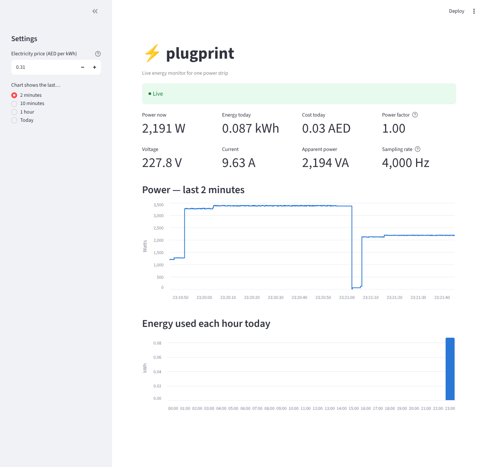

# plugprint dashboard

Live dashboard for the plugprint energy monitor: power right now, energy used today, cost in AED, and charts.



## The three pieces

| Script | Role | Analogy |
|---|---|---|
| `fake_plug.py` | Pretends to be the ESP32 (until the real one is running). Sends one reading every 200 ms, with imaginary appliances switching on and off. | the plug |
| `receiver.py` | Listens on UDP port 4210 and saves every reading to `data/live/YYYY-MM-DD.csv`. | the mailbox |
| `app.py` | Streamlit web page that reads those files and redraws every second. | the screen |

`config.py` holds the shared settings (port, tariff, folders).

Each reading is one small JSON message, identical from the fake and the real plug:

```json
{"t_ms": 51200, "v": 229.6, "i": 4.354, "p": 999.8, "s": 1000.1, "pf": 1.00, "rate": 4000.0, "late": 9}
```

## Running it (Windows)

One-time setup, from this folder:

```
py -m pip install -r requirements.txt
```

Then open **three** terminals in this folder:

```
py receiver.py
py fake_plug.py
py -m streamlit run app.py
```

The dashboard opens at <http://localhost:8501>. When the real plug is streaming, skip `fake_plug.py`.

The first time `receiver.py` runs, Windows Firewall may ask about network access. Allow it on **private networks**, so the real plug can reach the laptop.

## How energy and cost are worked out

Energy for each reading = power × time since the previous reading. That gives joules, and 3,600,000 J = 1 kWh. Gaps longer than 2 s (plug offline) are not counted. Cost = kWh × tariff. The default tariff is 0.31 AED/kWh (DEWA first slab + fuel surcharge + VAT), and you can change it in the sidebar.
